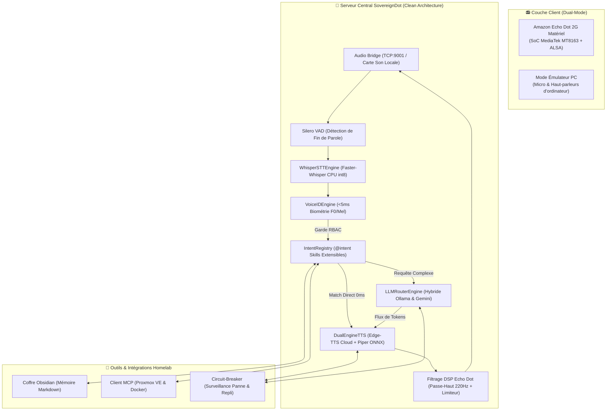
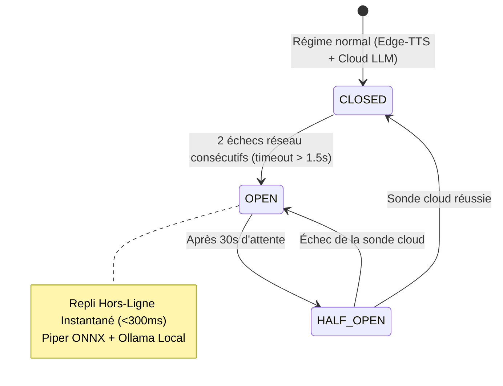

<div align="center">

# 🎙️ SovereignDot

### Transformez votre Amazon Echo Dot en assistant vocal IA 100% souverain et ultra-rapide

[](https://opensource.org/licenses/Apache-2.0)
[](https://www.python.org/)
[](https://www.docker.com/)
[](#-budget-de-latence--pipeline-streaming)
[](#-résilience-réseau--circuit-breaker)
[](#-biométrie-vocale-voiceid--contrôle-parental-rbac)
[](https://devmustroc.github.io/amazondot/)
[](#-tests-automatisés--ci)

<br/>

**[🇬🇧 English](README.md)** • **[🇫🇷 Français](README.fr.md)** • **[📖 Documentation Complète](https://devmustroc.github.io/amazondot/)**

<br/>

*Zéro télémétrie AWS. Zéro abonnement. 100% Homelab Local & IA Souveraine.*

<br/>

</div>

---

<a id="français"></a>

## 📑 Sommaire

- [⚡ La Vision](#-la-vision)
- [✨ Fonctionnalités Clés](#-fonctionnalités-clés)
- [🗣️ Exemples de Commandes Vocales Supportées](#-exemples-de-commandes-vocales-supportées)
- [🏛️ Architecture du Système](#-architecture-du-système)
- [⚡ Budget de Latence & Pipeline Streaming](#-budget-de-latence--pipeline-streaming)
- [⏱️ Démarrage Rapide en 60 Secondes (Mode Émulateur PC)](#-démarrage-rapide-en-60-secondes-mode-émulateur-pc)
- [🐳 Déploiement en Production (Docker & Homelab)](#-déploiement-en-production-docker--homelab)
- [📻 Libération Matérielle (Jailbreak Echo Dot 2G)](#-libération-matérielle-jailbreak-echo-dot-2g)
- [🧒 Biométrie Vocale VoiceID & Contrôle Parental (RBAC)](#-biométrie-vocale-voiceid--contrôle-parental-rbac)
- [🧠 Mémoire Atomique dans Obsidian](#-mémoire-atomique-dans-obsidian)
- [🛡️ Résilience Réseau & Circuit-Breaker](#-résilience-réseau--circuit-breaker)
- [🛠️ Supervision Homelab & SRE Proxmox](#-supervision-homelab--sre-proxmox)
- [🧩 Créer ses Propres Compétences Vocales (@intent)](#-créer-ses-propres-compétences-vocales-intent)
- [⚙️ Guide de Configuration (.env)](#-guide-de-configuration-env)
- [🧪 Tests Automatisés & CI](#-tests-automatisés--ci)
- [🤝 Contribution & Communauté](#-contribution--communauté)
- [📄 Licence & Crédits](#-licence--crédits)

---

## ⚡ La Vision

Plus de 40 millions d'enceintes Amazon Echo Dot 2ème génération dorment aujourd'hui dans des tiroirs ou des déchetteries. Dans le même temps, les enceintes connectées commerciales écoutent en continu, transmettent vos conversations intimes à des serveurs cloud distants, diffusent des publicités invasives et deviennent totalement muettes à la moindre coupure Internet.

**SovereignDot** apporte une réponse radicale et définitive :
1. **Recyclage Matériel Utile** : Nous libérons le matériel audio d'excellente facture de l'Echo Dot 2G (réseau de 7 microphones en beamforming, DAC Texas Instruments, transducteur 35 mm) de l'écosystème propriétaire d'Amazon.
2. **Confidentialité Totale** : Tous les traitements audio restent confinés à votre réseau local domestique. Zéro télémétrie, zéro compte cloud obligatoire.
3. **Latence Inférieure à la Seconde** : Un pipeline de streaming réactif token-par-phrase délivre des réponses vocales en **moins de 1 000 millisecondes**.
4. **Résilience Hors-Ligne** : En cas de coupure de votre box Internet, un **Circuit-Breaker** temps réel bascule instantanément sur la synthèse neuronale locale **Piper ONNX** et les modèles locaux **Ollama**.
5. **Ingénierie Homelab SRE** : Pilotez et surveillez votre cluster Proxmox VE, vos machines virtuelles et vos conteneurs Docker à la voix.

> **Vous n'avez pas encore d'Echo Dot ?** Aucun problème ! SovereignDot intègre un **Mode Émulateur PC** qui vous permet d'exécuter et de tester l'intégralité de l'assistant avec le microphone et les haut-parleurs de votre ordinateur en 60 secondes !

---

## ✨ Fonctionnalités Clés

| Capacité | Implémentation SovereignDot | Assistants Commerciaux (Alexa / Google) |
| :--- | :--- | :--- |
| **Vie Privée & Flux Audio** | 100% Local / Réseau Homelab. Zéro espionnage. | Transmis en continu aux serveurs des GAFAM. |
| **Latence Voix-à-Voix** | **< 1 000 ms** (buffer streaming token-to-sentence). | 2 000 ms à 4 500 ms de latence cloud typique. |
| **Fonctionnement Hors-Ligne** | **Repli instantané (<300ms)** via Piper ONNX & Ollama. | Panne complète (*"J'ai du mal à me connecter"*). |
| **Biométrie Vocale** | **VoiceID (<5ms)** : Pitch F0 + Centroïde Mel sur CPU. | Profils cloud opaques ou inexistants. |
| **Sécurité Enfant (RBAC)** | **Contrôle d'accès strict** : Les enfants n'ont pas accès au SRE. | Accès indifférencié ou code PIN fastidieux. |
| **Mémoire Long-Terme** | **Fichiers Markdown purs** dans votre coffre Obsidian. | Base de données fermée et inexploitable. |
| **Homelab & SRE** | Audit Proxmox VE & Docker natif via **MCP**. | Non supporté sans passerelles cloud complexes. |
| **Compatibilité Matérielle**| Echo Dot 2G jailbreaké **OU** n'importe quel PC / Mac / Linux. | Verrouillé au matériel du constructeur. |
| **Extensibilité** | **Décorateur `@intent`** : Écrivez un skill en 10 lignes de Python. | Processus de validation fermé et lourd. |

---

## 🗣️ Exemples de Commandes Vocales Supportées

SovereignDot répond aux mots de réveil (**"Régis"**, **"Alexa"**) et traite aussi bien les intentions directes à 0 ms de latence que les questions complexes :

### 🕒 Vie Quotidienne & Horloge (Latence 0 ms)
- *"Régis, quelle heure est-il ?"* $\to$ *"Il est actuellement 14 heures 25."*
- *"Régis, quel jour sommes-nous ?"* $\to$ *"Nous sommes le lundi 9 novembre 2026."*
- *"Régis, qui es-tu ?"* $\to$ *"Je m'appelle Régis, je suis l'assistant vocal IA familial pour la maison de El Mustapha."*

### 🧒 Biométrie Vocale VoiceID (Reconnaissance Instantanée de l'Orateur)
- *"Régis, qui suis-je ?"* $\to$ *"D'après ton empreinte vocale, tu es El Mustapha, avec le profil admin."*
- *(Prononcé par un enfant)* *"Régis, qui suis-je ?"* $\to$ *"D'après ton empreinte vocale, tu es Ismail, avec le profil child."*
- *(Enfant demandant Proxmox)* *"Régis, quel est l'état du serveur ?"* $\to$ **Bloqué par le RBAC** : *"Désolé Ismail, l'accès aux commandes d'administration du serveur est réservé aux adultes."*

### 🧠 Mémoire Persistante Obsidian
- *"Régis, retiens que Ismail adore jouer aux échecs."* $\to$ Écrit dans `vault/Memory/Famille.md` et confirme : *"C'est bien noté dans ma mémoire Famille, j'ai enregistré que Ismail adore jouer aux échecs."*
- *"Régis, que sais-tu sur les échecs ?"* $\to$ *"D'après mes notes dans Famille : Ismail adore jouer aux échecs."*

### 🖥️ Supervision Homelab SRE & Docker (MCP)
- *"Régis, quel est l'état du serveur Proxmox ?"* $\to$ *"Le serveur Proxmox est en ligne avec un uptime de 14 jours. L'utilisation processeur est à 18 pourcents, 24 Go de RAM alloués sur 64."*
- *"Régis, combien de machines virtuelles tournent ?"* $\to$ *"Le cluster héberge actuellement 5 machines virtuelles et 8 conteneurs LXC opérationnels."*
- *"Régis, est-ce que Mamitales tourne ?"* $\to$ *"Le conteneur mamitales-backend est opérationnel depuis 4 jours."*
- *"Régis, quel est l'état des conteneurs Docker ?"* $\to$ *"12 conteneurs Docker sont en cours d'exécution sur le CT 105."*

### 🛡️ Diagnostic Réseau & Résilience
- *"Régis, quel est l'état du réseau ?"* $\to$ *"Le circuit réseau est CLOSED. Nous sommes connecté au cloud. 0 bascules de secours enregistrées."*

---

## 🏛️ Architecture du Système



---

## ⚡ Budget de Latence & Pipeline Streaming

SovereignDot atteint une fluidité de conversation naturelle grâce à un pipeline asynchrone pipeliné de bout en bout :

| Étape | Sous-Système | Latence |
| :--- | :--- | :--- |
| **Détection Fin de Parole** | Silero VAD (Détecte l'arrêt de la voix) | **80 ms** |
| **Reconnaissance Vocale (STT)**| Faster-Whisper `tiny` (CPU int8, beam 1) | **120 ms** |
| **Identification Biométrique** | VoiceID (Autocorrélation F0 + Centroïde Mel) | **< 5 ms** |
| **Routage d'Intention Directe**| Registre Modulaire (`@intent`) | **< 1 ms** |
| **Génération 1ère Phrase LLM**| OpenRouter Gemini 3.8 Flash (Token-to-Sentence) | **250 ms** |
| **Synthèse Vocale (TTS)** | Dual-Engine TTS (Edge-TTS ou Cache RAM) | **220 ms** |
| **Filtrage DSP Matériel** | Passe-Haut Butterworth 220Hz + Stéréo 48kHz | **20 ms** |
| **Total Voix-à-Voix** | **Pipeline Streaming Complet** | **< 700 ms** |

---

## ⏱️ Démarrage Rapide en 60 Secondes (Mode Émulateur PC)

Vous pouvez lancer et tester SovereignDot immédiatement sur votre PC sans aucun matériel Amazon.

### 1. Cloner le Dépôt

```bash
git clone https://github.com/Devmustroc/amazondot.git
cd amazondot
```

### 2. Configurer l'Environnement Virtuel Python

```bash
python3 -m venv .venv
source .venv/bin/activate
pip install -r requirements.txt
```

### 3. Configurer le Fichier `.env` pour le Mode Local

```bash
cp .env.example .env
```

Vérifiez que votre fichier `.env` contient :
```ini
AUDIO_INPUT_MODE=local
OPENROUTER_API_KEY=votre_cle_optionnelle  # Si omise, Ollama local sera utilisé automatiquement
```

### 4. Lancer SovereignDot

```bash
python -m core_server.main
```

Au premier démarrage, SovereignDot télécharge automatiquement le modèle officiel Piper ONNX en français (63 Mo) et initialise votre coffre de mémoire Markdown dans `./vault/Memory/`.  
En Mode Émulateur PC, vous pouvez **soit taper votre question au clavier** dans le terminal, **soit appuyer sur Entrée à vide pour enregistrer 4 secondes depuis votre microphone** :

> **« Régis, quelle heure est-il ? »**  
> **« Régis, retiens que Ismail adore jouer aux échecs. »**

---

## 🐳 Déploiement en Production (Docker & Homelab)

Pour déployer SovereignDot comme service permanent sur votre serveur Proxmox, un NAS ou un conteneur dédié :

```bash
# Compiler et lancer en mode réseau hôte
docker compose up -d --build

# Consulter les journaux en direct
docker compose logs -f sovereigndot
```

### Lancer la Sonde de Santé Automatisée

```bash
python -m core_server.healthcheck
```

Résultat :
```text
2026-11-09 10:00:00 [INFO] Circuit-Breaker: CLOSED (0 fallbacks)
2026-11-09 10:00:00 [INFO] Piper TTS Model: Ready (63.2 MB)
2026-11-09 10:00:00 [INFO] VoiceID Engine: 2 enrolled profiles
2026-11-09 10:00:00 [INFO] Intent Registry: 10 active voice skills
2026-11-09 10:00:00 [INFO] Obsidian Vault: Ready (./vault/Memory)
Healthcheck PASSED: ALL SUBSYSTEMS GREEN.
```

---

## 📻 Libération Matérielle (Jailbreak Echo Dot 2G)

SovereignDot applique une méthodologie **Clean-Room stricte** : aucun firmware propriétaire Amazon, aucun blob sous droit d'auteur ni aucune clé cryptographique extraite ne sont hébergés dans ce dépôt.

### Spécifications Matérielles de l'Echo Dot 2G
- **SoC** : MediaTek MT8163V (Quad-Core ARM Cortex-A53 @ 1.3 GHz 64-bit)
- **Mémoire Vive** : 512 Mo LPDDR3
- **Entrée Audio** : Réseau circulaire de 7 micros avec ADC Texas Instruments & DSP matériel
- **Sortie Audio** : Transducteur 35 mm + Amplificateur Class-D + Sortie Jack 3,5 mm stéréo
- **Réseau** : Wi-Fi bibande 802.11 a/b/g/n + Bluetooth 4.0

### Résumé des Étapes de Libération
1. **Télécharger les Outils Open-Source** :
   ```bash
   chmod +x tools/fetch_blobs.sh
   ./tools/fetch_blobs.sh
   ```
2. **Injection BootROM (Exploit Kamakiri)** : Reliez le point de test eMMC `CLK` à la masse `GND` pour forcer le mode BootROM MediaTek (`0e8d:0003`).
3. **U-Boot & Shell Root** : Flashez le bootloader open-source U-Boot et démarrez l'environnement root BusyBox.
4. **Déployer `dot_bridge`** : Installez le démon C ultra-léger écoutant sur le port `TCP:9001`.

👉 **Consultez le guide matériel complet et illustré dans [docs/hardware/echo-dot-2g.md](docs/hardware/echo-dot-2g.md)**.

---

## 🧒 Biométrie Vocale VoiceID & Contrôle Parental (RBAC)

SovereignDot intègre un moteur biométrique vocal qui identifie l'orateur en moins de 5 ms sur CPU, sans carte graphique :
- **Fréquence Fondamentale ($F_0$)** : Autocorrélation normalisée sur les voyelles (Homme adulte : 85-155Hz, Femme adulte : 165-255Hz, Enfant : 260-450Hz).
- **Centroïde Spectral Mel** : Analyse le timbre et les formants vocaux.
- **Stockage Chiffré AES-GCM-256** : Vos profils biométriques sont chiffrés au repos dans `core_server/data/voice_profiles.enc`.

### Matrice des Rôles et Permissions (RBAC)

| Profil Utilisateur | Rôle | Droits d'Accès |
| :--- | :--- | :--- |
| **El Mustapha** | `ADMIN` | Accès total : Proxmox SRE, Docker, lecture/écriture Obsidian, paramètres système. |
| **Adultes** | `ADULT` | Domotique, calendrier, météo, conversation générale. |
| **Ismail (Enfant)** | `CHILD` | Histoires, jeux, calculs, devoirs. **Commandes serveurs et SRE strictement interdites**. |
| **Invités** | `GUEST` | Heure, date, météo publique, blagues. Aucun accès à la mémoire privée. |

---

## 🧠 Mémoire Atomique dans Obsidian

Vos préférences et souvenirs familiaux sont enregistrés directement sous forme de notes Markdown claires dans votre coffre :

```text
vault/Memory/
├── Famille.md      # Anniversaires, activités, devoirs des enfants
├── Homelab.md      # Adresses IP, rôles des VM, sauvegardes
├── Santé.md        # Allergies, médecins de famille
└── Divers.md       # Mémos rapides et faits généraux
```

Lorsqu'une question complexe est posée au LLM, SovereignDot recherche les lignes les plus pertinentes dans ces fichiers et les injecte automatiquement dans le contexte du prompt système.

---

## 🛡️ Résilience Réseau & Circuit-Breaker

SovereignDot garantit une assistance vocale continue, même en cas de panne de votre connexion Internet :



- **`CLOSED`** : Voix neuronale Microsoft Edge-TTS haute fidélité (`fr-FR-HenriNeural`).
- **`OPEN`** : Court-circuite totalement Internet. Synthèse vocale générée par **Piper ONNX** en **< 280 ms** sur CPU.
- Interrogez l'état du réseau à tout moment : *"Régis, quel est l'état du réseau ?"*

---

## 🛠️ Supervision Homelab & SRE Proxmox

Grâce au protocole ouvert **Model Context Protocol (MCP)**, SovereignDot transforme votre enceinte en véritable console d'opérations SRE :
- **Santé Proxmox VE** : Uptime, pourcentage de charge processeur, mémoire vive allouée.
- **Machines Virtuelles & Conteneurs LXC** : Nombre de VM actives vs éteintes, vue d'ensemble du cluster.
- **Conteneurs Docker** : Surveillance globale ou par conteneur spécifique (`mamitales-backend`, `immich_server`, `vaultwarden`).

---

## 🧩 Créer ses Propres Compétences Vocales (@intent)

Ajouter une nouvelle commande vocale ne prend que 10 lignes de Python grâce au registre modulaire d'intentions :

```python
# core_server/intents/blague_skill.py
from typing import AsyncGenerator
from core_server.intents.base import BaseIntent, IntentContext, intent

@intent
class BlagueSkill(BaseIntent):
    name = "raconter_blague"
    priority = 25              # Plus le chiffre est petit, plus la priorité est haute
    requires_admin = False     # Mettre à True pour réserver la commande aux adultes

    def can_handle(self, ctx: IntentContext) -> bool:
        return "blague" in ctx.clean_prompt.lower()

    async def execute(self, ctx: IntentContext) -> AsyncGenerator[str, None]:
        yield "Pourquoi les plongeurs plongent-ils toujours en arrière et jamais en avant ? Parce que sinon ils tombent dans le bateau !"
```

Aucune modification du code central n'est requise ! Votre compétence est enregistrée automatiquement au démarrage.

👉 **Tutoriel de plugin complet disponible dans [docs/contributing/writing-intents.md](docs/contributing/writing-intents.md)**.

---

## ⚙️ Guide de Configuration (.env)

| Variable | Valeur par Défaut | Description |
| :--- | :--- | :--- |
| `AUDIO_INPUT_MODE` | `echo_dot` | Définir à `local` pour le Mode Émulateur PC ou `echo_dot` pour le mode matériel. |
| `DOT_HOST` | `192.168.1.23` | Adresse IP de votre Echo Dot 2G libéré sur le Wi-Fi local. |
| `DOT_MIC_PORT` | `9000` | Port TCP du flux brut 9-canaux des microphones de l'Echo Dot. |
| `DOT_PLAY_PORT` | `9001` | Port TCP de lecture stéréo 48kHz & contrôle des LEDs sur l'Echo Dot. |
| `WHISPER_MODEL` | `tiny` | Modèle Faster-Whisper (`tiny`, `base`, `small`). |
| `WHISPER_BEAM_SIZE`| `1` | Largeur du faisceau Whisper (1 = ultra-rapide <120ms). |
| `OPENROUTER_API_KEY`| `""` | Clé API OpenRouter pour le streaming Gemini 3.8 Flash. |
| `OLLAMA_URL` | `http://localhost:11434/api/chat` | Endpoint local Ollama pour les requêtes privées hors-ligne. |
| `OLLAMA_MODEL` | `qwen2.5:latest` | Nom du modèle Ollama local. |
| `TTS_VOICE` | `fr-FR-VivienneMultilingualNeural`| Voix neuronale Edge-TTS pour la synthèse en ligne. |
| `PIPER_ENABLED` | `true` | Active le repli vocal hors-ligne Piper ONNX. |
| `OBSIDIAN_VAULT_PATH`| `./vault/Memory`| Chemin du dossier local des notes Markdown. |
| `FAMILY_ADMIN_NAME` | `El Mustapha` | Nom du profil administrateur adulte. |

---

## 🧪 Tests Automatisés & CI

SovereignDot comprend une suite complète de tests unitaires et d'intégration validée à 100% :

```bash
# Lancer l'intégralité de la suite de tests
python -m unittest discover tests

# Ou lancer les tests spécifiques par domaine
python -m unittest tests/test_intent_registry.py       # Skills Modulaires & RBAC
python -m unittest tests/test_resilience_fallback.py   # Latence & Circuit Breaker
python -m unittest tests/test_voice_id.py              # Empreintes Biométriques
python -m unittest tests/test_obsidian_memory.py       # Mémoire Markdown
python -m unittest tests/test_healthcheck.py           # Diagnostic Production
```

Les 25 tests s'exécutent en moins de 6 secondes sur un processeur standard.

---

## 🤝 Contribution & Communauté

Les contributions sont les bienvenues ! Que vous souhaitiez :
- Porter SovereignDot sur un nouveau matériel (Echo Dot 3G, Google Home Mini).
- Écrire de nouveaux skills vocaux (`@intent`).
- Améliorer les dictionnaires de correction phonétique.

Consultez notre [Guide de Contribution](docs/contributing/writing-intents.md) et ouvrez une Pull Request !

---

## 📄 Licence & Crédits

Distribué sous la licence **Apache 2.0**. Voir [`LICENSE`](LICENSE) pour plus de détails.

- **Auteur** : El Mustapha ([@Devmustroc](https://github.com/Devmustroc))
- **Architecture** : Conçue en pair-programming assisté par Gemini (CTO) & Claude 3.7.
- **Projet Frère** : Propulse les fondations technologiques de [Mamitales](https://github.com/Devmustroc/mamitales), les histoires familiales personnalisées par IA.
