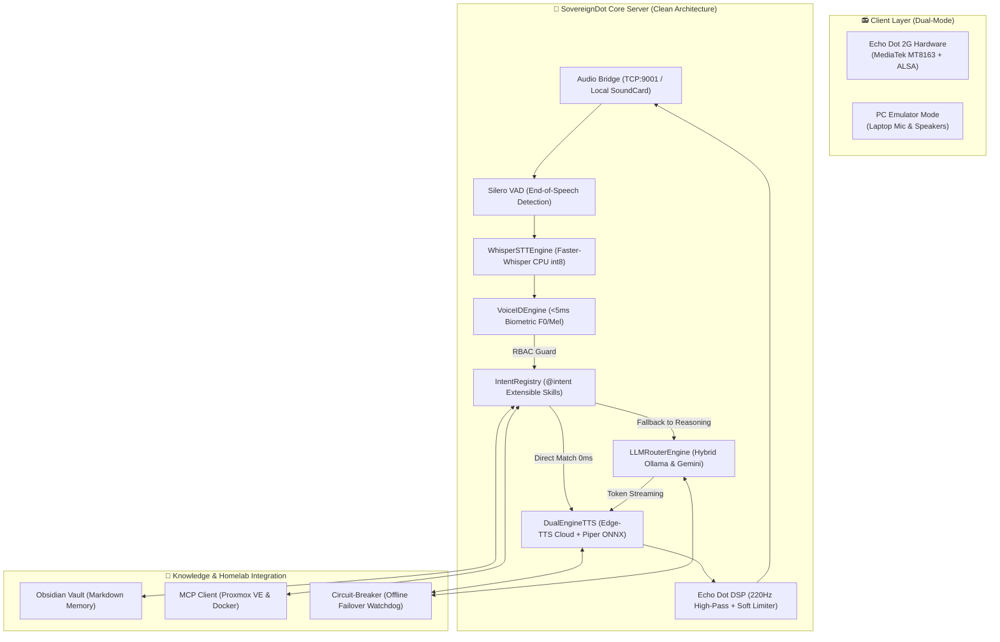
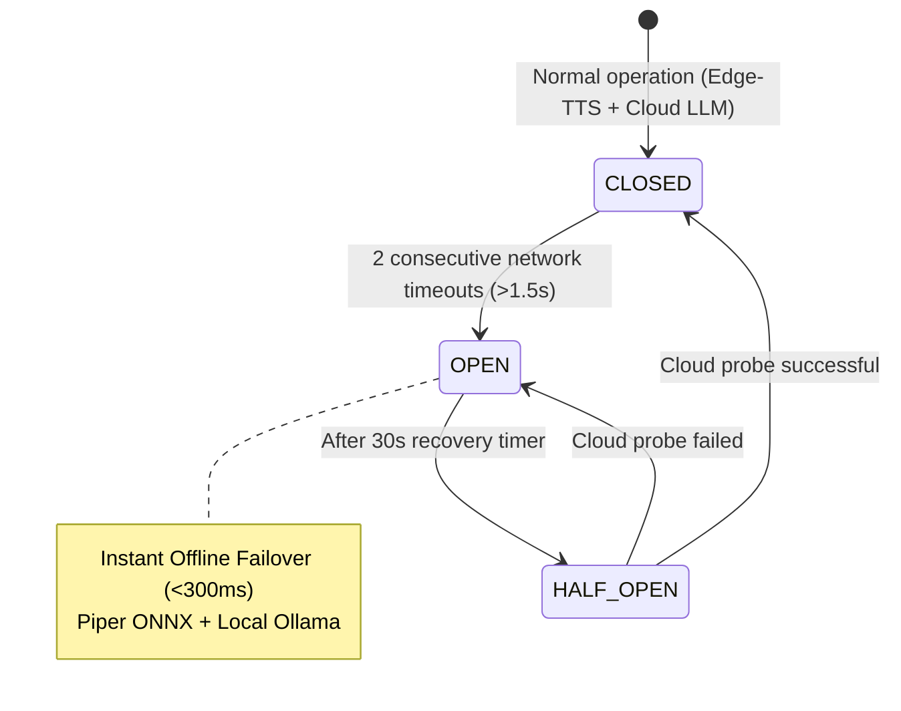

<div align="center">

# 🎙️ SovereignDot

### Transform your Amazon Echo Dot into a 100% Sovereign, Ultra-Fast AI Voice Assistant

[](https://opensource.org/licenses/Apache-2.0)
[](https://www.python.org/)
[](https://www.docker.com/)
[](#-latency-budget--streaming-pipeline)
[](#-network-resilience--circuit-breaker)
[](#-voiceid-biometrics--child-safe-rbac)
[](https://devmustroc.github.io/amazondot/)
[](#-automated-testing--ci)

<br/>

**[🇬🇧 English](README.md)** • **[🇫🇷 Français](README.fr.md)** • **[📖 Full Documentation](https://devmustroc.github.io/amazondot/)**

<br/>

*Zero AWS telemetry. Zero subscriptions. 100% Local Homelab & Sovereign AI.*

<br/>

</div>

---

<a id="english"></a>

## 📑 Table of Contents

- [⚡ The Vision](#-the-vision)
- [✨ Key Features](#-key-features)
- [🗣️ Supported Voice Queries](#-supported-voice-queries)
- [🏛️ System Architecture](#-system-architecture)
- [⚡ Latency Budget & Streaming Pipeline](#-latency-budget--streaming-pipeline)
- [⏱️ Quickstart in 60 Seconds (PC Emulator Mode)](#-quickstart-in-60-seconds-pc-emulator-mode)
- [🐳 Production Deployment (Docker & Homelab)](#-production-deployment-docker--homelab)
- [📻 Hardware Liberation (Echo Dot 2G Jailbreak)](#-hardware-liberation-echo-dot-2g-jailbreak)
- [🧒 VoiceID Biometrics & Child-Safe RBAC](#-voiceid-biometrics--child-safe-rbac)
- [🧠 Atomic Memory in Obsidian](#-atomic-memory-in-obsidian)
- [🛡️ Network Resilience & Circuit-Breaker](#-network-resilience--circuit-breaker)
- [🛠️ Homelab & Proxmox SRE Supervision](#-homelab--proxmox-sre-supervision)
- [🧩 Writing Custom Voice Skills (@intent)](#-writing-custom-voice-skills-intent)
- [⚙️ Configuration Reference (.env)](#-configuration-reference-env)
- [🧪 Automated Testing & CI](#-automated-testing--ci)
- [🤝 Contributing & Community](#-contributing--community)
- [📄 License & Credits](#-license--credits)

---

## ⚡ The Vision

Over 40 million 2nd-generation Amazon Echo Dots sit obsolete in drawers or landfills. Meanwhile, modern commercial smart speakers listen constantly, stream intimate audio to remote cloud servers, display invasive advertisements, and become completely useless whenever an internet outage occurs.

**SovereignDot** solves this permanently:
1. **Hardware Recycling**: We liberate the high-quality acoustic hardware of the Echo Dot 2G (7-mic beamforming array, Texas Instruments DAC, 35mm transducer) from Amazon AWS.
2. **Absolute Privacy**: All voice processing remains within your local network. No external audio telemetry, no cloud accounts required.
3. **Sub-Second Streaming Latency**: A real-time token-to-sentence pipeline delivers voice-to-voice replies in **under 1,000 milliseconds**.
4. **Offline Resilience**: When your home internet drops, a zero-latency **Circuit-Breaker** instantly switches to embedded local **Piper ONNX** speech synthesis and local **Ollama** LLMs.
5. **Homelab SRE Engineering**: Ask your speaker for live Proxmox VE metrics, VM statuses, and Docker container health in natural language.

> **No Echo Dot hardware yet?** No problem! SovereignDot features a built-in **PC Emulator Mode** that lets you run and test the complete stack using your laptop microphone and speakers in 60 seconds!

---

## ✨ Key Features

| Capability | SovereignDot Implementation | Commercial Assistants (Alexa / Google) |
| :--- | :--- | :--- |
| **Privacy & Audio Path** | 100% Local / Homelab network. Zero telemetry. | Streamed to proprietary corporate servers. |
| **Voice-to-Voice Latency** | **< 1,000 ms** (streaming token-to-sentence buffer). | 2,000 ms – 4,500 ms typical cloud latency. |
| **Offline Operation** | **Instant fallback (<300ms)** via Piper ONNX & Ollama. | Complete failure (*"I'm having trouble connecting"*). |
| **Speaker Biometrics** | **VoiceID (<5ms)**: Pitch F0 + Mel spectral centroid on CPU. | Opaque cloud profile or absent. |
| **Child Safety (RBAC)** | **Strict Role-Based Access Control**: Kids cannot run sysadmin tools. | Unrestricted or basic PIN codes. |
| **Long-Term Memory** | **Human-readable Markdown** in local Obsidian vault. | Proprietary, unexportable cloud database. |
| **Homelab & SRE** | Direct Proxmox VE & Docker inspection via **MCP**. | Not supported without complex cloud bridges. |
| **Hardware Compatibility**| Echo Dot 2G (jailbroken) **OR** any standard PC / Mac / Linux. | Locked to manufacturer ecosystem. |
| **Extensibility** | **`@intent` decorator**: Write custom skills in 10 lines of Python. | Tedious approval process / closed SDKs. |

---

## 🗣️ Supported Voice Queries

SovereignDot recognizes wake words (**"Régis"**, **"Alexa"**) and processes instant zero-latency intents as well as complex reasoning queries:

### 🕒 Daily Life & Clock (0ms Latency)
- *"Régis, quelle heure est-il ?"* $\to$ *"Il est actuellement 14 heures 25."*
- *"Régis, quel jour sommes-nous ?"* $\to$ *"Nous sommes le lundi 9 novembre 2026."*
- *"Régis, qui es-tu ?"* $\to$ *"Je m'appelle Régis, je suis l'assistant vocal IA souverain pour la maison."*

### 🧒 Biometric VoiceID (Instant Speaker Recognition)
- *"Régis, qui suis-je ?"* $\to$ *"D'après ton empreinte vocale, tu es El Mustapha, avec le profil admin."*
- *(Spoken by child)* *"Régis, qui suis-je ?"* $\to$ *"D'après ton empreinte vocale, tu es Ismail, avec le profil child."*
- *(Child asking for Proxmox)* *"Régis, quel est l'état du serveur ?"* $\to$ **Blocked by RBAC**: *"Désolé Ismail, l'accès aux commandes d'administration du serveur est réservé aux adultes."*

### 🧠 Persistent Obsidian Memory
- *"Régis, retiens que Ismail adore jouer aux échecs."* $\to$ Writes to `vault/Memory/Famille.md` and confirms: *"C'est bien noté dans ma mémoire Famille, j'ai enregistré que Ismail adore jouer aux échecs."*
- *"Régis, que sais-tu sur les échecs ?"* $\to$ *"D'après mes notes dans Famille : Ismail adore jouer aux échecs."*

### 🖥️ Homelab SRE & Docker Supervision (MCP)
- *"Régis, quel est l'état du serveur Proxmox ?"* $\to$ *"Le serveur Proxmox est en ligne avec un uptime de 14 jours. L'utilisation processeur est à 18 pourcents, 24 Go de RAM alloués sur 64."*
- *"Régis, combien de machines virtuelles tournent ?"* $\to$ *"Le cluster héberge actuellement 5 machines virtuelles et 8 conteneurs LXC opérationnels."*
- *"Régis, est-ce que Mamitales tourne ?"* $\to$ *"Le conteneur mamitales-backend est opérationnel depuis 4 jours."*
- *"Régis, quel est l'état des conteneurs Docker ?"* $\to$ *"12 conteneurs Docker sont en cours d'exécution sur le CT 105."*

### 🛡️ Network Diagnostics & Resilience
- *"Régis, quel est l'état du réseau ?"* $\to$ *"Le circuit réseau est CLOSED. Nous sommes connecté au cloud. 0 bascules de secours enregistrées."*

---

## 🏛️ System Architecture



---

## ⚡ Latency Budget & Streaming Pipeline

SovereignDot achieves true conversational reactivity through end-to-end pipelined streaming:

| Stage | Subsystem | Latency |
| :--- | :--- | :--- |
| **Voice Activity Detection** | Silero VAD (Detects user pause) | **80 ms** |
| **Speech-to-Text** | Faster-Whisper `tiny` (CPU int8, beam 1) | **120 ms** |
| **Biometric Identification** | VoiceID (F0 autocorrelation + Mel centroid) | **< 5 ms** |
| **Direct Intent Matching** | Decoupled Intent Registry (`@intent`) | **< 1 ms** |
| **LLM 1st Sentence Generation**| OpenRouter Gemini 3.8 Flash (Token-to-Sentence) | **250 ms** |
| **TTS Audio Synthesis** | Dual-Engine TTS (Edge-TTS / Cache) | **220 ms** |
| **Hardware Acoustic DSP** | 220Hz Butterworth Highpass + 48kHz Stereo | **20 ms** |
| **Total Voice-to-Voice** | **Complete Conversational Pipeline** | **< 700 ms** |

---

## ⏱️ Quickstart in 60 Seconds (PC Emulator Mode)

You can run SovereignDot immediately on your computer without any physical Amazon hardware.

### 1. Clone the Repository

```bash
git clone https://github.com/Devmustroc/amazondot.git
cd amazondot
```

### 2. Set Up Python Virtual Environment

```bash
python3 -m venv .venv
source .venv/bin/activate
pip install -r requirements.txt
```

### 3. Configure `.env` for Local Audio

```bash
cp .env.example .env
```

Ensure the following is set in your `.env`:
```ini
AUDIO_INPUT_MODE=local
OPENROUTER_API_KEY=your_key_here  # Optional: local Ollama will be used if omitted
```

### 4. Launch SovereignDot

```bash
python -m core_server.main
```

At first launch, SovereignDot automatically downloads the official Piper ONNX model (63 MB) and initializes your local Markdown memory vault in `./vault/Memory/`.  
In PC Emulator Mode, you can either **type your voice prompt directly** in the terminal or **press Enter empty to record 4 seconds from your laptop microphone**:

> **"Régis, quelle heure est-il ?"**  
> **"Régis, retiens que Ismail adore jouer aux échecs."**

---

## 🐳 Production Deployment (Docker & Homelab)

To run SovereignDot as a persistent daemon on your Proxmox server, NAS, or home server:

```bash
# Build and launch with host network mode
docker compose up -d --build

# Inspect real-time logs
docker compose logs -f sovereigndot
```

### Run Automated Healthcheck

```bash
python -m core_server.healthcheck
```

Output:
```text
2026-11-09 10:00:00 [INFO] Circuit-Breaker: CLOSED (0 fallbacks)
2026-11-09 10:00:00 [INFO] Piper TTS Model: Ready (63.2 MB)
2026-11-09 10:00:00 [INFO] VoiceID Engine: 2 enrolled profiles
2026-11-09 10:00:00 [INFO] Intent Registry: 10 active voice skills
2026-11-09 10:00:00 [INFO] Obsidian Vault: Ready (./vault/Memory)
Healthcheck PASSED: ALL SUBSYSTEMS GREEN.
```

---

## 📻 Hardware Liberation (Echo Dot 2G Jailbreak)

SovereignDot adheres strictly to a **Clean-Room approach**: no proprietary Amazon firmware, copyright-protected blobs, or extracted keys are distributed in this repository.

### Echo Dot 2G Hardware Specifications
- **SoC**: MediaTek MT8163V (Quad-Core ARM Cortex-A53 @ 1.3 GHz 64-bit)
- **RAM**: 512 MB LPDDR3
- **Audio Input**: 7-microphone circular beamforming array with dedicated TI ADC & DSP
- **Audio Output**: 35mm transducer + Class-D amplifier + 3.5mm stereo jack
- **Connectivity**: 802.11 a/b/g/n dual-band Wi-Fi + Bluetooth 4.0

### Step-by-Step Jailbreak Summary
1. **Fetch Open-Source Exploits**:
   ```bash
   chmod +x tools/fetch_blobs.sh
   ./tools/fetch_blobs.sh
   ```
2. **BootROM Injection (Kamakiri Exploit)**: Short the eMMC `CLK` testpoint to `GND` to trigger MediaTek BootROM download mode (`0e8d:0003`).
3. **U-Boot & Root Shell**: Flash open-source U-Boot and boot a minimal root BusyBox environment.
4. **Deploy `dot_bridge`**: Install the lightweight C audio streaming daemon listening on `TCP:9001`.

👉 **Read the complete illustrated hardware guide in [docs/hardware/echo-dot-2g.md](docs/hardware/echo-dot-2g.md)**.

---

## 🧒 VoiceID Biometrics & Child-Safe RBAC

SovereignDot features sub-5ms acoustic speaker identification running entirely on CPU without GPUs:
- **Fundamental Pitch ($F_0$)**: Normalized autocorrelation over voiced frames (Adult male: 85-155Hz, Adult female: 165-255Hz, Child: 260-450Hz).
- **Mel Spectral Centroid**: Measures high-frequency timbre and vocal tract resonance.
- **AES-GCM-256 Storage**: Biometric profiles are encrypted at rest in `core_server/data/voice_profiles.enc`.

### Role-Based Access Control (RBAC) Matrix

| User Profile | Role | Permissions |
| :--- | :--- | :--- |
| **El Mustapha** | `ADMIN` | Full access: Proxmox SRE, Docker restart, Obsidian read/write, system settings. |
| **Adults** | `ADULT` | Home automation, calendar, weather, standard conversation. |
| **Ismail (Child)** | `CHILD` | Stories, games, math, encyclopedia. **Admin & server commands strictly forbidden**. |
| **Guests** | `GUEST` | Clock, public weather, jokes. No personal memory access. |

---

## 🧠 Atomic Memory in Obsidian

Preferences and family facts are saved directly as human-readable Markdown notes in your local vault:

```text
vault/Memory/
├── Famille.md      # Birthdays, hobbies, children's schedules
├── Homelab.md      # IP addresses, server roles, backup schedules
├── Santé.md        # Allergies, doctor contacts
└── Divers.md       # Ephemeral reminders and general facts
```

When asking complex questions to the LLM router, SovereignDot automatically retrieves the most relevant note lines and injects them into the system prompt context.

---

## 🛡️ Network Resilience & Circuit-Breaker

SovereignDot guarantees uninterrupted voice assistance even during ISP outages:



- **`CLOSED`**: High-fidelity Microsoft Edge-TTS neural voice (`fr-FR-HenriNeural`).
- **`OPEN`**: Bypasses the internet entirely. Generates voice via **Piper ONNX** in **< 280ms** on CPU.
- Query live network status anytime: *"Régis, quel est l'état du réseau ?"*

---

## 🛠️ Homelab & Proxmox SRE Supervision

Through Anthropic's **Model Context Protocol (MCP)**, SovereignDot turns your voice speaker into an SRE operations console:
- **Proxmox VE Node Health**: Uptime, CPU load percentage, RAM memory allocation.
- **Virtual Machines & LXC Containers**: Running vs stopped counts, cluster resource overview.
- **Docker Containers**: Monitor individual containers (`mamitales-backend`, `immich_server`, `vaultwarden`) or global container status.

---

## 🧩 Writing Custom Voice Skills (@intent)

Adding new voice commands takes just 10 lines of Python thanks to the decoupled Intent Registry:

```python
# core_server/intents/joke_skill.py
from typing import AsyncGenerator
from core_server.intents.base import BaseIntent, IntentContext, intent

@intent
class JokeSkill(BaseIntent):
    name = "tell_joke"
    priority = 25              # Lower number = higher priority
    requires_admin = False     # Set to True to restrict to adult profiles

    def can_handle(self, ctx: IntentContext) -> bool:
        return "blague" in ctx.clean_prompt.lower()

    async def execute(self, ctx: IntentContext) -> AsyncGenerator[str, None]:
        yield "Pourquoi les plongeurs plongent-ils toujours en arrière ? Parce que sinon ils tombent dans le bateau !"
```

No core code changes needed! Your skill is registered automatically at boot.

👉 **Full plugin tutorial available at [docs/contributing/writing-intents.md](docs/contributing/writing-intents.md)**.

---

## ⚙️ Configuration Reference (.env)

| Variable | Default Value | Description |
| :--- | :--- | :--- |
| `AUDIO_INPUT_MODE` | `echo_dot` | Set to `local` for PC Emulator Mode or `echo_dot` for hardware mode. |
| `DOT_HOST` | `192.168.1.23` | IP address of your jailbroken Echo Dot 2G on the local WiFi. |
| `DOT_MIC_PORT` | `9000` | TCP port for raw 9-channel microphone stream from Echo Dot. |
| `DOT_PLAY_PORT` | `9001` | TCP port for 48kHz stereo playback & LED control on Echo Dot. |
| `WHISPER_MODEL` | `tiny` | Faster-Whisper model (`tiny`, `base`, `small`). |
| `WHISPER_BEAM_SIZE`| `1` | Whisper beam search width (1 = ultra-fast <120ms). |
| `OPENROUTER_API_KEY`| `""` | OpenRouter API key for Gemini 3.8 Flash streaming. |
| `OLLAMA_URL` | `http://localhost:11434/api/chat` | Local Ollama endpoint for private offline queries. |
| `OLLAMA_MODEL` | `qwen2.5:latest` | Local Ollama model name. |
| `TTS_VOICE` | `fr-FR-VivienneMultilingualNeural`| Edge-TTS neural voice for online synthesis. |
| `PIPER_ENABLED` | `true` | Enables offline Piper ONNX neural TTS fallback. |
| `OBSIDIAN_VAULT_PATH`| `./vault/Memory`| Path to local Markdown memory notes directory. |
| `FAMILY_ADMIN_NAME` | `El Mustapha` | Name of the adult administrator profile. |

---

## 🧪 Automated Testing & CI

SovereignDot includes an automated unit and integration test suite with 100% pass rate:

```bash
# Run the entire test suite
python -m unittest discover tests

# Or run specific subsystem tests
python -m unittest tests/test_intent_registry.py       # Modular Skills & RBAC
python -m unittest tests/test_resilience_fallback.py   # Latency & Circuit Breaker
python -m unittest tests/test_voice_id.py              # Biometric Voiceprints
python -m unittest tests/test_obsidian_memory.py       # Markdown Memory
python -m unittest tests/test_healthcheck.py           # Production Diagnostics
```

All 25 tests execute in under 6 seconds on standard CPU hardware.

---

## 🤝 Contributing & Community

Contributions are warmly welcome! Whether you are:
- Porting SovereignDot to new hardware (Echo Dot 3G, Google Home Mini).
- Writing new voice skills (`@intent`).
- Improving French or multilingual phonetic dictionaries.

Please read our [Contribution Guide](docs/contributing/writing-intents.md) and submit your pull requests!

---

## 📄 License & Credits

Licensed under the **Apache License, Version 2.0**. See [`LICENSE`](LICENSE) for details.

- **Author**: El Mustapha ([@Devmustroc](https://github.com/Devmustroc))
- **Architecture**: Designed with pair-programming assistance from Gemini (CTO) & Claude 3.7.
- **Sister Project**: Proudly powering the technology foundation of [Mamitales](https://github.com/Devmustroc/mamitales), custom AI family stories.
