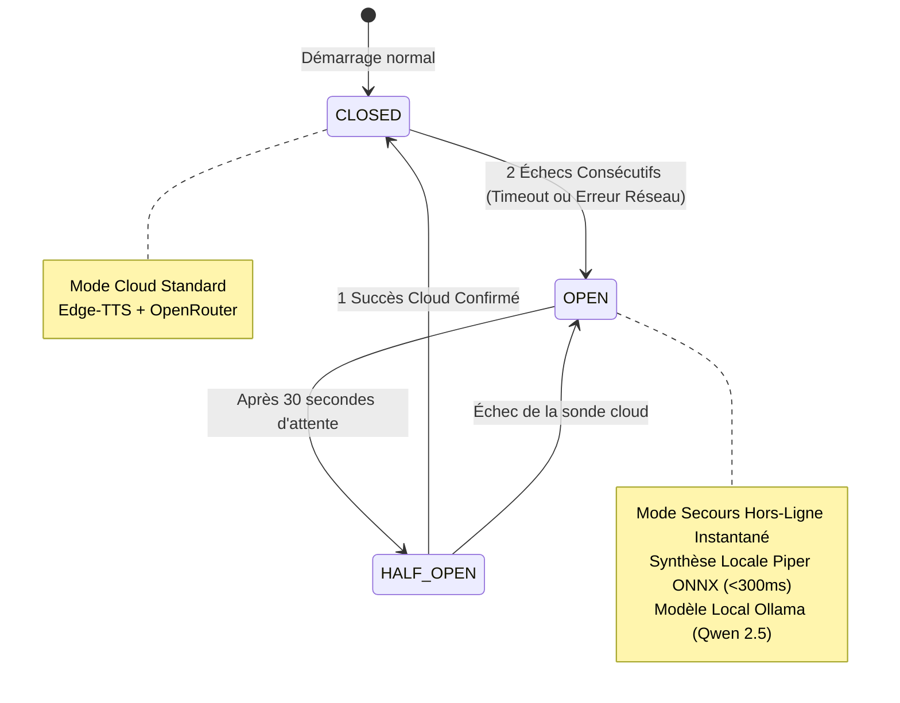

# Résilience Réseau & Circuit-Breaker

Un assistant vocal souverain doit rester opérationnel en toutes circonstances, y compris lorsque la connexion Internet de votre domicile est interrompue ou que les services cloud tiers subissent une panne.  
SovereignDot intègre un sous-système de résilience architecturé selon le pattern **Circuit-Breaker** ([`core_server/resilience.py`](file:///home/devmust/Work/amazondot/core_server/resilience.py)).

---

## 🛡️ Machine à États du Circuit-Breaker

Le disjoncteur réseau surveille en continu la santé des appels vers les API distantes (Edge-TTS et OpenRouter) :

### 1. État `CLOSED` (Fonctionnement Normal)
- Toutes les synthèses vocales utilisent Microsoft Edge-TTS haute fidélité (`fr-FR-HenriNeural`).
- Les requêtes complexes exploitent le modèle distant Google Gemini via OpenRouter.
- Tout appel dépassant le timeout strict de **1,5 seconde** est considéré comme une anomalie.

### 2. État `OPEN` (Panne Détectée / Mode Hors-Ligne)
- Dès que 2 échecs consécutifs sont constatés, le disjoncteur bascule immédiatement en mode `OPEN`.
- **Zéro tentative d'appel réseau** : les requêtes cloud sont court-circuitées sans attendre d'erreur réseau.
- La synthèse vocale est confiée instantanément au moteur neuronal embarqué **Piper ONNX**.
- Les intentions complexes sont réacheminées vers **Ollama (Qwen 2.5)** sur le réseau local.

### 3. État `HALF_OPEN` (Sonde de Rétablissement)
- Au bout de 30 secondes (paramétrable via `CIRCUIT_BREAKER_RESET_TIMEOUT_SEC`), une requête sonde est autorisée vers le cloud.
- Si elle aboutit, le circuit se referme (`CLOSED`) et reprend son régime de croisière.
- Si elle échoue, le circuit se rouvre immédiatement sans perturber l'expérience vocale de l'utilisateur.

---

## 🎙️ Le Moteur Hors-Ligne Piper ONNX

Piper est un moteur de synthèse vocale ultra-rapide basé sur l'architecture VITS et exécuté via ONNX Runtime sur CPU.

- **Modèle officiel** : `fr_FR-upmc-medium` (63 Mo).
- **Auto-Téléchargement** : Téléchargé et vérifié automatiquement au premier démarrage de SovereignDot.
- **Performances** : Synthèse d'une phrase complète en **moins de 280 millisecondes** sur un processeur standard (sans GPU).
- **Empreinte mémoire** : Moins de 120 Mo de RAM.

---

## 🗣️ Interroger l'État du Réseau à la Voix

Vous pouvez demander à tout moment à l'assistant :

> **« Régis, quel est l'état du réseau ? »**

SovereignDot répondra instantanément avec l'état exact du circuit :
> *« Le circuit réseau est CLOSED. Nous sommes connecté au cloud. 0 bascules de secours enregistrées. »*  
> ou  
> *« Le circuit réseau est OPEN. Nous sommes hors ligne avec repli local Piper ONNX. 1 bascules de secours enregistrées. »*
