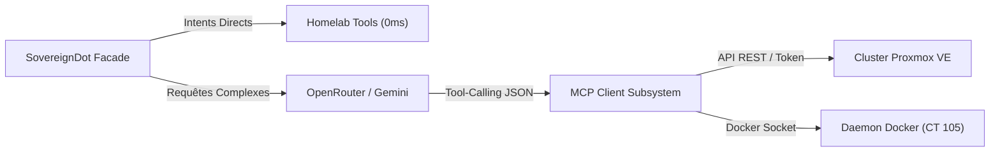

# Supervision Homelab & SRE Proxmox

SovereignDot ne se contente pas de vous donner l'heure ou la météo : c'est un véritable **ingénieur SRE vocal** capable d'auditer l'infrastructure de votre Homelab et de piloter votre cluster domestique à la voix ([`core_server/homelab_tools.py`](file:///home/devmust/Work/amazondot/core_server/homelab_tools.py) et [`core_server/mcp_client.py`](file:///home/devmust/Work/amazondot/core_server/mcp_client.py)).

---

## 🔌 Architecture MCP (Model Context Protocol)

SovereignDot implémente le standard ouvert **Model Context Protocol (MCP)** développé par Anthropic. Ce protocole permet à l'assistant de dialoguer avec des serveurs d'outils standardisés :

---

## 🖥️ Supervision Proxmox VE à la Voix

Vous pouvez interroger l'état de votre nœud ou de votre cluster en langage naturel :

> **« Régis, quel est l'état du serveur ? »**  
> **« Régis, comment va Proxmox ? »**  
> **« Régis, quelle est la charge du cluster ? »**

SovereignDot interroge l'API Proxmox VE en temps réel et synthétise une réponse claire :
> *« Le serveur Proxmox est en ligne avec un uptime de 14 jours. L'utilisation du processeur est à 18 pourcents, et 24 gigaoctets de mémoire vive sont alloués sur 64. Aucun incident détecté. »*

Pour connaître l'état des machines virtuelles :

> **« Régis, combien de machines virtuelles tournent ? »**

> *« Le cluster héberge actuellement 5 machines virtuelles et 8 conteneurs LXC, tous opérationnels. »*

---

## 🐳 Supervision Docker & Applications Métier

L'assistant surveille les conteneurs Docker de votre Homelab (soit globalement, soit par application) :

### 1. État Global de Docker
> **« Régis, quel est l'état des conteneurs Docker ? »**  
> *« 12 conteneurs Docker sont actuellement en cours d'exécution sur le conteneur CT 105, aucun conteneur n'est arrêté ou en erreur. »*

### 2. État d'une Application Spécifique
> **« Régis, est-ce que Mamitales tourne ? »**  
> *« Le conteneur mamitales-backend est opérationnel depuis 4 jours avec un statut de santé vert. »*

> **« Régis, quel est le statut de Vaultwarden ? »**  
> *« Le gestionnaire de mots de passe Vaultwarden est en ligne et répond normalement. »*

---

## 🔒 Sécurité RBAC Intégrée

Conformément à la politique de sécurité de SovereignDot, toutes les commandes d'administration serveur (`proxmox_status`, `docker_status`) nécessitent le rôle **`ADMIN`** ou **`ADULT`**. Si un enfant ou un invité tente d'exécuter ces commandes, la requête est immédiatement bloquée.
