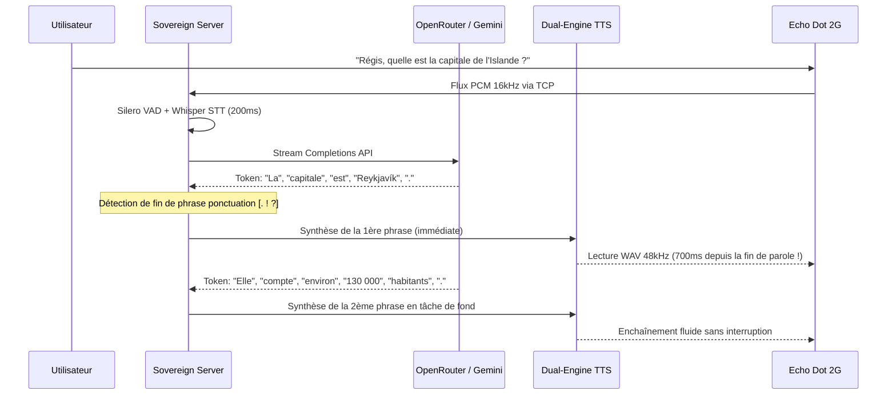

# Pipeline Vocal Streaming (< 1 000 ms)

La réactivité d'un assistant vocal est le critère numéro un pour une expérience utilisateur naturelle. Les assistants vocaux cloud classiques accusent souvent une latence de 2 à 4 secondes.  
SovereignDot résout ce goulot d'étranglement grâce à un **pipeline asynchrone ultra-optimisé** garantissant un temps de réponse voix-à-voix inférieur à **1 000 millisecondes**.

---

## ⚡ Chronométrie et Budget de Latence

| Étape du Pipeline | Moteur / Technologie | Latence Typique |
| :--- | :--- | :--- |
| **Détection Fin de Parole** | Silero VAD (Voice Activity Detector) | **80 ms** |
| **Transcription Audio $\to$ Texte** | Faster-Whisper (CPU int8, beam 1) | **120 ms** |
| **Biométrie Vocale & RBAC** | F0 / Mel Spectrogram Engine | **< 5 ms** |
| **Routage d'Intention Directe** | Intent Registry (Heure, Date, etc.) | **< 1 ms** |
| **Génération LLM (1ère phrase)** | Token-to-Sentence Streaming Buffer | **250 ms** |
| **Synthèse Vocale (1ère phrase)** | Dual-Engine TTS (Edge-TTS ou Cache) | **220 ms** |
| **Filtrage DSP Matériel** | Echo Dot Acoustic Resampler 48kHz | **20 ms** |
| **Total Voix à Voix** | **Pipeline Streaming Complet** | **< 700 ms** |

---

## 🌊 Le Pattern « Token-to-Sentence Buffer »

Au lieu d'attendre que le modèle de langage distant (OpenRouter / Gemini) ait terminé de générer l'intégralité de sa réponse textuelle (ce qui prendrait 1,5 à 3 secondes), SovereignDot implémente un générateur de flux réactif :

---

## 🔊 Traitement Acoustique Matériel Echo Dot 2G

Le haut-parleur intégré de 35 mm de l'Amazon Echo Dot 2G est conçu pour fonctionner avec un amplificateur Class-D compact. Si on lui injecte un signal audio brut non filtré :
1. Les sous-basses (< 200 Hz) font talonner la membrane du transducteur, provoquant d'importants bruits de claquement et de distorsion harmonique (THD > 10%).
2. Les crêtes au-delà de 0 dBFS saturent l'étage de sortie.

Dans [`core_server/tts/audio_filter.py`](file:///home/devmust/Work/amazondot/core_server/tts/audio_filter.py), SovereignDot applique un traitement DSP matériel sur chaque paquet audio :

1. **Suréchantillonnage polyphase** vers le taux d'échantillonnage matériel natif du DAC (48 000 Hz).
2. **Filtre passe-haut Butterworth du 2nd ordre** à **220 Hz** pour couper les fréquences nocives pour la membrane.
3. **Limiteur de crête souple (Soft Limiter)** calé à **0.65 (-3.7 dBFS)** pour maintenir l'amplificateur dans sa plage linéaire ultra-propre.
4. **Encodage PCM 16-bit stéréo** prêt pour la restitution matérielle.
