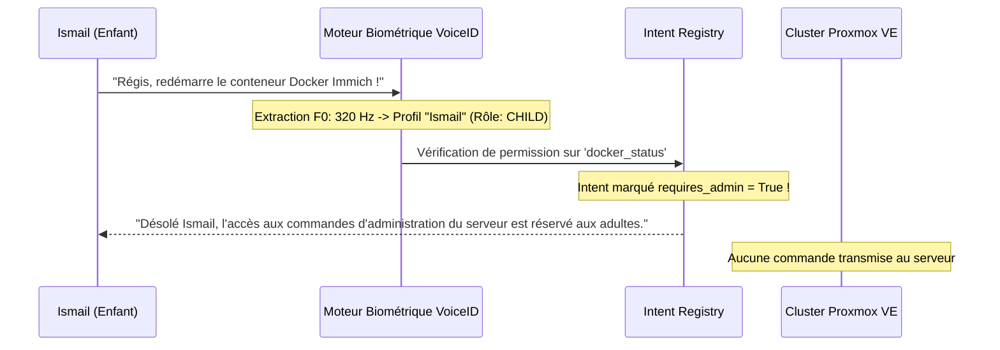

# Biométrie Vocale VoiceID & RBAC Sécurisé

Dans un foyer connecté, tous les utilisateurs n'ont pas les mêmes droits. Un enfant ne doit pas pouvoir éteindre une machine virtuelle Proxmox ou consulter les mots de passe du gestionnaire familial, tandis qu'un invité ne doit pas accéder aux notes privées.  
SovereignDot intègre un moteur biométrique vocal natif couplé à un système de contrôle d'accès basé sur les rôles (**RBAC**), localisé dans [`core_server/voice_id.py`](https://github.com/Devmustroc/amazondot/blob/master/core_server/voice_id.py).

---

## 🔬 Reconnaissance Biométrique sans GPU (< 5 ms)

Pour éviter les modèles d'empreinte vocale lourds (> 500 Mo) nécessitant des cartes graphiques dédiées, SovereignDot utilise une méthode acoustique ultra-légère basée sur l'analyse spectrale et le pitch :

1. **Extraction de la Fréquence Fondamentale ($F_0$)** :
   Calculée par autocorrélation normalisée sur les segments voisés du signal audio (pitch moyen de la voix).
   - Homme adulte typique : 85 Hz – 155 Hz.
   - Femme adulte typique : 165 Hz – 255 Hz.
   - Enfant : 260 Hz – 450 Hz.
2. **Calcul du Centroïde Spectral (Brillance & Timbre)** :
   Mesure la distribution d'énergie fréquentielle à travers les banques de filtres Mel.
3. **Classification Euclidienne Normalisée & Confiance** :
   L'identification s'exécute en **moins de 3 millisecondes** sur CPU avec un score de confiance calculé en temps réel.

---

## 👥 Rôles et Matrice des Permissions (RBAC)

SovereignDot définit quatre niveaux hiérarchiques de privilèges :

| Rôle | Profil Typique | Permissions & Accès |
| :--- | :--- | :--- |
| **`ADMIN`** | Chef de famille (`El Mustapha`) | Accès illimité : Homelab SRE, redémarrage, lecture/écriture Obsidian, gestion des utilisateurs. |
| **`ADULT`** | Conjoint(e) / Adultes du foyer | Commandes de confort, domotique, météo, création de rappels, lecture des notes communes. |
| **`CHILD`** | Enfants (`Ismail`) | Musique, histoires, culture générale, devoirs. **Interdiction totale des commandes système et serveurs**. |
| **`GUEST`** | Invités | Heure, date, blagues, météo publique. Aucune donnée personnelle consultable. |

---

## 🛑 Blocage Proactif des Commandes Enfants

Dès qu'un flux vocal est identifié comme provenant d'un profil enfant (`UserRole.CHILD`) ou présentant un pitch supérieur à 240 Hz, le sous-système RBAC intercepte immédiatement la commande avant même qu'elle ne soit transmise aux moteurs d'intention ou au LLM :

---

## 🔐 Chiffrement des Profils Vocaux (AES-256 GCM)

La vie privée biométrique est primordiale. Les empreintes vocales de votre famille ne sont jamais stockées en clair.  
Elles sont sérialisées et chiffrées dans `core_server/data/voice_profiles.enc` à l'aide d'un algorithme de chiffrement authentifié **AES-256 en mode GCM** avec dérivation de clé SHA-256. Même en cas de vol du stockage physique, les données biométriques restent inviolables.

---

## 🗣️ Tester son Identité Vocale

Dites simplement à votre Echo Dot :

> **« Régis, qui suis-je ? »**

L'assistant répond instantanément en analysant votre voix en direct :
> *« D'après ton empreinte vocale, tu es Ismail, avec le profil child. »*  
> ou  
> *« D'après ton empreinte vocale, tu es El Mustapha, avec le profil admin. »*
