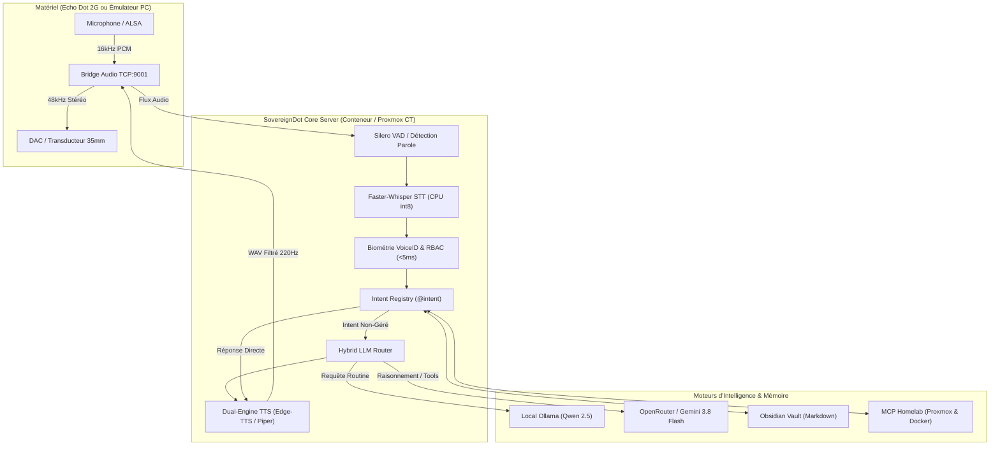

# SovereignDot — Assistant Vocal IA 100% Souverain

> **Transformez votre Amazon Echo Dot 2G en enceinte intelligente souveraine, connectée à votre Homelab et respectueuse de votre vie privée.**

Bienvenue sur la documentation officielle de **SovereignDot** (projet TAD — The Sovereign Amazon Dot).  
SovereignDot est une plateforme logicielle et matérielle open-source permettant de libérer votre Amazon Echo Dot de l'écosystème cloud fermé d'Amazon pour en faire un agent vocal autonome propulsé par vos propres modèles d'intelligence artificielle.

---

## ⚡ Pourquoi SovereignDot ?

La plupart des assistants vocaux commerciaux envoient en permanence vos conversations vers des serveurs distants, cessent de fonctionner en cas de panne Internet et ne peuvent pas interagir avec vos serveurs locaux. SovereignDot résout ces trois problèmes majeurs :

- **100% Souverain & Privé** : Vos flux audio restent cantonnés à votre réseau local. Aucun espionnage ni exploitation publicitaire.
- **Ultra-Faible Latence (< 1 000 ms)** : Pipeline streaming réactif de bout en bout (Silero VAD $\to$ Faster-Whisper $\to$ Token-to-Sentence $\to$ Edge-TTS).
- **Résilience Totale & Circuit-Breaker** : En cas de coupure Internet, SovereignDot bascule en moins de 300 ms sur son moteur neuronal local **Piper ONNX**.
- **Biométrie Vocale VoiceID & Contrôle Parental** : Identification de l'orateur en moins de 5 ms par extraction F0/Mel et blocage des commandes d'administration pour les enfants.
- **Supervision Homelab & SRE** : Pilotage vocal de votre cluster Proxmox VE et de vos conteneurs Docker via Model Context Protocol (MCP).
- **Mémoire Long-terme Markdown** : Mémorisation et rappel instantané synchronisés avec votre coffre **Obsidian**.
- **Architecture Extensible `@intent`** : Créez vos propres commandes vocales en 10 lignes de Python sans toucher au cœur du système.

---

## 🏛️ Vue d'Ensemble de l'Architecture

---

## 🚀 Navigation Rapide

- [Guide de Démarrage Rapide (60 secondes)](getting-started/quickstart.md) : Démarrez sur votre PC sans Echo Dot physique.
- [Guide de Configuration `.env`](getting-started/configuration.md) : Personnalisez tous les paramètres et clés API.
- [Libération Hardware Echo Dot 2G](hardware/echo-dot-2g.md) : Tutoriel pas à pas pour flash u-boot et rooter l'appareil.
- [Développer des Intentions Vocales](contributing/writing-intents.md) : Apprenez à créer vos propres skills en quelques lignes.

---

> [!NOTE] Projet Frère : Mamitales
> Vous aimez l'IA vocale appliquée à la famille ? Découvrez également [Mamitales](https://mamitales.com), notre plateforme d'histoires personnalisées générées par IA pour les enfants et grands-parents !
